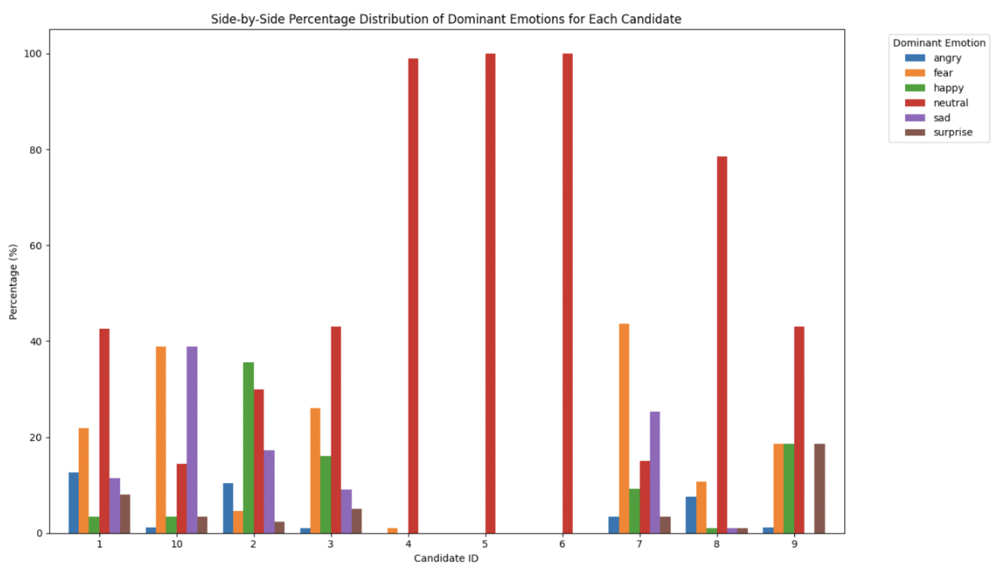
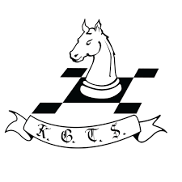

# Mathew Manoj

**Data Science & AI** · M.Tech Dual Degree, IIT Kharagpur

Hi, I'm Mathew — an undergraduate at IIT Kharagpur who enjoys building AI systems that solve real-world problems, from on-device LLMs to chatbots and predictive models. I've interned at **Amazon**, **Tech Mahindra**, **Cellstrat**, **Prodoc AI**, and **Ernst & Young**.

Take a look around, and feel free to reach out if you'd like to collaborate!

---

## 🧰 Technical Skills

| Category | Tools |
| --- | --- |
| **Languages** | Python, C++ |
| **Libraries & Frameworks** | TensorFlow, Scikit-Learn, Pandas, NumPy, SciPy, Matplotlib, Seaborn |
| **Cloud** | AWS (including Bedrock) |
| **Developer Tools** | Git, VS Code, Jupyter Notebook, Google Colab, MATLAB, Xcode |

---

## 🎓 Education

| Degree | Institution | Year |
| --- | --- | --- |
| M.Tech Dual Degree, Biotechnology | IIT Kharagpur | Expected 2026 |
| Higher Secondary (XII) | FIITJEE World School | 2021 |
| Secondary (X) | FIITJEE World School | 2018 |

---

## 💼 Work Experience

### Amazon — Applied Scientist Intern

*Bangalore · May '25 – Oct '25*

- Fine-tuned a **1.5B-parameter LLM** to predict API calls vs. natural-language responses on edge devices.
- Used **distillation** to teach the model when to run queries locally and when to offload them.
- Achieved high accuracy in both **API invocation** and **decision routing** for production use.

### Prodoc AI — Data Science Intern

*Bangalore · Dec '24*

- Trained **DeBERTa** for **end-of-conversation detection** with strong accuracy and precision.
- Built a **voice activity detection (VAD)** module to separate speech from noise, improving conversation flow and timing.
- Deployed the model on **Hugging Face** and integrated it into healthcare apps, boosting user engagement.

### Tech Mahindra Maker's Lab — AI Research Intern

*Pune · Jun '24 – Sep '24*

- Researched **deploying LLMs on edge devices** such as the Raspberry Pi.
- Contributed to **Project Indus**, building LLMs for Indian languages.
- Took part in foundational research on scalable AI systems.

### Cellstrat Inc — Data Science Intern

*Bangalore · Jan '24 – Present*

- Enhanced a **knowledge-mining chatbot** using AWS services.
- Built a chatbot on the **Amazon Titan** model for an AWS workshop.
- Evaluated **50+ voices** and **30–40 prompts** for PhoneCallGPT.

### Ernst & Young (EY) LLP — Data Analytics Intern

*Bangalore · Jun '23 – Jul '23*

- Developed a **3-layer LSTM** for **sales prediction**, reaching an **MAE of 0.0919**.
- Used **LeakyReLU** activations and **MSE** loss to improve prediction accuracy.

### Follicular Stage Identification — Computer Vision Research Intern

*IIT Kharagpur · May '23 – Present*

- Classified **ovarian follicle stages** from **2D fluorescence images**.
- Analyzed images to measure cellular thickness and identify growth phases.

---

## 🛠️ Projects

### Emotion-Led Candidate Analysis

*Self project · Aug '24* · [GitHub](https://github.com/mathew-2/Emotion-Led-Candidate-Analysis)

- Performed exploratory data analysis on **candidate profiles** to uncover **emotion-led patterns** in recruitment.
- Visualized trends in **emotions**, **sentiment**, and **personality traits** with Matplotlib and Seaborn.
- Derived insights to support **data-driven recruitment** strategies.

### PubMed Paper Scraper

*Self project · Jul '24* · [Live App](https://pubmed-paper-scraper.streamlit.app/) · [GitHub](https://github.com/mathew-2/pubmed-paper-scraper)

- Streamlit app that searches and retrieves **academic papers** from **PubMed** by topic.
- Shows each paper's **title**, **journal**, **publication date**, and **abstract**, with links back to PubMed.
- Includes **error handling** and **rate limiting**.

### PDF to HTML Resume Converter

*Self project · Aug '24* · [Live App](https://pdf-to-html-tamsyidwjjlsmqpzz2ekdz.streamlit.app/) · [GitHub](https://github.com/mathew-2/PDF-To-Html)

- Converts **LinkedIn PDF resumes** into polished **HTML** using the OpenAI API.
- Built with **Streamlit** for the interface and **PyPDF2** for text extraction.

### Chatbot Development Using AWS

*Internship project · Jan '24*

- Built a chatbot with **AWS Bedrock** and **AWS Lambda**.
- Implemented a web adapter layer for streaming responses.
- Produced outputs of up to **20 tokens**, and investigated the challenges with longer outputs.

➡️ **[See more projects](projects/README.md)**

---

## 🏆 Competitions

### Meta Hackathon · Oct '24

- Built a WhatsApp-based conversational agent using **Meta Llama** models to analyze customer satisfaction and identify product needs.
- Used **Python**, **LangChain**, **MongoDB**, and **ChromaDB** for context retrieval.
- [GitHub](https://github.com/mathew-2/PDF-To-Html)

### Unit Liability Prediction · Inter-Hall Data Analytics Competition · Feb–Mar '23

- Built a model predicting manufacturing-unit safety with **97% accuracy**, placing **1st in accuracy**.

### Fintech Website · Inter-Hall Open Soft Competition · Mar '23

- Developed a SaaS platform for financial services using **React.js**, **Node.js**, and **MongoDB**.

---

## 🏅 Positions of Responsibility

### Academic Head — Kharagpur Game Theory Society

*IIT Kharagpur · Aug '23 – Apr '24*

- Organized workshops on game theory and coordinated the flagship event, **Stratathon**.

---

## ⚽ Extracurriculars

- **Football:** Member of the bronze-winning Vidyasagar Hall of Residence team.
- **Swimming:** Competed in events with the Technology Aquatics Society, IIT Kharagpur.
- **Cultural:** Organized Pongal celebrations for the IIT Kharagpur Tamil Sangam, drawing 200+ attendees.

---

## 🔗 Let's Connect

[GitHub](https://github.com/mathew-2) · [LinkedIn](https://www.linkedin.com/in/mathew-manoj) · [X / Twitter](https://x.com/mattdraco13)

Feel free to explore my projects, and don't hesitate to reach out if you'd like to collaborate or have any questions!
