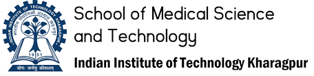
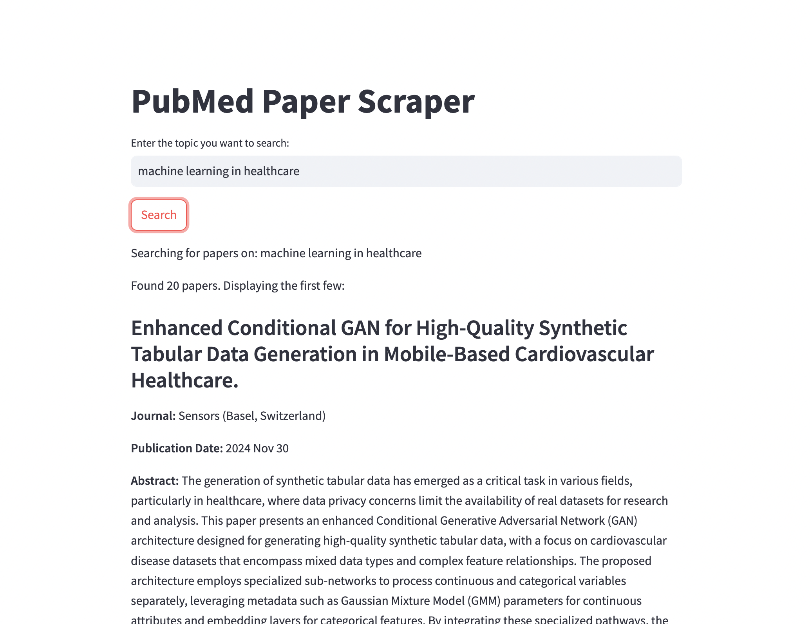

# Hi, I'm Mathew Manoj 👋

  

I'm a dual-degree student at **IIT Kharagpur** who builds and ships ML systems. Most recently I was an **Applied Scientist Intern at Amazon**, fine-tuning and distilling a 1.5B-parameter LLM to run on edge devices. Before that I worked on LLMs and speech at **Prodoc AI**, **Tech Mahindra Maker's Lab**, **Cellstrat** and **EY**.

  
  
  

---

## 🧰 Tech Stack

  
  
  
  
  
  
  
  
  
  
  
  
  
  

---

## 💼 Experience

  

    <h3>Applied Scientist Intern</h3>
    
<b>Amazon</b> · Bangalore · May '25 – Oct '25

  

  

- Fine-tuned a **1.5B LLM** to decide between an **API call** and a **natural-language reply** on edge devices. <!-- TODO: add accuracy figure -->
- Used **distillation** to teach the model when to answer locally and when to hand off to the cloud, reaching production-level routing accuracy.

  

    <h3>Data Science Intern</h3>
    
<b>Prodoc AI</b> · Bangalore · Dec '24

  

  

- Trained **DeBERTa** for **end-of-conversation detection** in healthcare voice apps. <!-- TODO: add accuracy / precision -->
- Built a **voice activity detection (VAD)** module and deployed the model on **Hugging Face**.

  

    <h3>AI Research Intern</h3>
    
<b>Tech Mahindra Maker's Lab</b> · Pune · Jun '24 – Sep '24

  

  

- Researched **deploying LLMs on edge devices** such as the Raspberry Pi.
- Contributed to **Project Indus**, an LLM for Indian languages.

  

    <h3>Data Science Intern</h3>
    
<b>Cellstrat</b> · Bangalore · Jan '24
 <!-- TODO: add end date -->
  

  

- Improved a **knowledge-mining chatbot** on AWS and built an **Amazon Titan** chatbot for an AWS workshop.
- Evaluated **50+ voices** and **30–40 prompts** for PhoneCallGPT.

  

    <h3>Data Analytics Intern</h3>
    
<b>EY</b> · Bangalore · Jun '23 – Jul '23

  

  

- Built a **3-layer LSTM** for **sales forecasting** with an **MAE of 0.0919**.

  

    <h3>Computer Vision Research Intern</h3>
    
<b>IIT Kharagpur</b> · Follicular Stage Identification · May '23
 <!-- TODO: add end date -->
  

  

- Classified **ovarian follicle stages** from 2D fluorescence images by measuring cell-layer thickness.

---

## 🛠️ Featured Projects

<table>
  <tr>
    <td width="50%" valign="top">
       
      <b>🏆 WhatsApp Customer Insights Agent</b> 
      Meta Hackathon · Oct '24 
      A WhatsApp agent built on Meta Llama that reads customer conversations to measure satisfaction and spot product needs. Uses LangChain, MongoDB and ChromaDB for retrieval.
    </td>
    <td width="50%" valign="top">
       
      <b>📚 PubMed Paper Scraper</b> 
      Self project · Jul '24 
      A Streamlit app that searches PubMed by topic and shows titles, journals, dates and abstracts, with rate limiting built in. 
      
      
    </td>
  </tr>
  <tr>
    <td width="50%" valign="top">
       
      <b>🎭 Emotion-Led Candidate Analysis</b> 
      Self project · Aug '24 
      Exploratory analysis of candidate profiles that charts emotion, sentiment and personality patterns in recruitment. 
      
    </td>
    <td width="50%" valign="top">
      <b>📄 PDF → HTML Resume Converter</b> 
      Self project · Aug '24 
      Turns LinkedIn PDF resumes into clean HTML pages using PyPDF2 and the OpenAI API, with a Streamlit front end. 
      
      
        
      <b>☁️ AWS Bedrock Chatbot</b> 
      Cellstrat · Jan '24 
      A streaming chatbot on AWS Bedrock and Lambda, using a web adapter layer to stream responses.
    </td>
  </tr>
</table>

👉 **[More projects](projects/README.md)**: stock prediction with an LSTM, K-means on SAP sales data, a movie recommender, and next-word prediction.

---

## 🏅 Achievements & Leadership

- 🥇 **1st place in accuracy**, Inter Hall Data Analytics competition (Feb '23): predicted manufacturing-unit safety with **97% accuracy**.
- 💻 **Inter Hall Opensoft** (Mar '23): built a fintech SaaS platform with React, Node.js and MongoDB.
-  **Academic Head, Kharagpur Game Theory Society** (Aug '23 – Apr '24): ran game-theory workshops and coordinated the flagship event Stratathon.

## 🎓 Education

| Degree | Institution | Year |
|---|---|---|
| M.Tech Dual Degree, Biotechnology | IIT Kharagpur | 2026 (expected) |
| Class XII | FIITJEE World School | 2021 |
| Class X | FIITJEE World School | 2018 |

## ⚽ Beyond Work

⚽ Bronze-winning football team, Vidyasagar Hall · 🏊 Technology Aquatics Society · 🎉 Organised Pongal for the IIT KGP Tamil Sangam (200+ attendees)

---

<b>Open to collaborations in LLMs, edge AI and applied ML. Let's talk!</b>  
  
  

